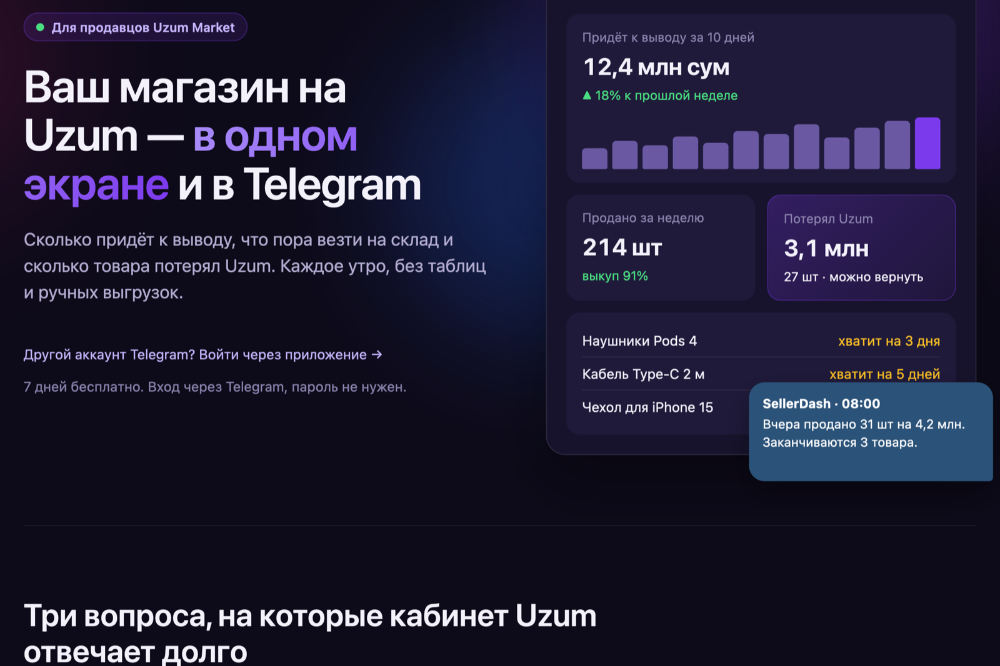
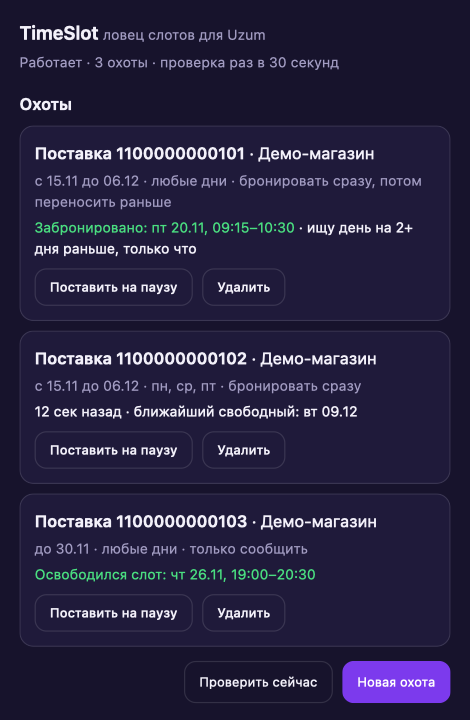

# Марсель Веселый · Marsel Vesyoliy

**Python-разработчик. Делаю инструменты для продавцов маркетплейсов: аналитика, Telegram-боты, браузерные расширения.**
**Python developer building tools for marketplace sellers: analytics, Telegram bots, browser extensions.**

[Русский](#русский) · [English](#english)

---

## Русский

Пишу сервисы от идеи до работающего продукта: код, сервер, бот, сайт, оплата. Мои проекты решают реальные задачи продавцов Uzum Market, крупнейшего маркетплейса Узбекистана, и ими уже пользуются.

### Проекты

#### 📊 SellerDash — аналитика для продавцов Uzum Market
[sellerdash.uz](https://sellerdash.uz) · код закрытый

Сервис по подписке: продавец подключает магазин по API-ключу и каждое утро получает в Telegram сводку, а на сайте — дашборд.
- **Выплаты, остатки, продажи** по всем магазинам продавца; прогноз, когда товар закончится.
- **Поиск потерянных товаров:** сверка поставок, продаж, возвратов и остатков. Компенсация считается по правилам Uzum, претензии собираются в Word и PDF автоматически.
- **План поставок**, рейтинг FBS, платное хранение, зависшие заказы.
- Подписки и тарифы, оферта, двуязычный сайт (русский и узбекский).

**Стек:** Python, FastAPI, pandas, Telegram Bot API, Uzum Seller API, python-docx, fpdf2. Сервер Ubuntu: systemd, nginx, ночная выкладка по таймеру, бэкапы. API-ключи клиентов хранятся зашифрованными, около 130 автотестов.

#### 🎯 TimeSlot — ловец слотов поставок
Расширение Chrome · код закрытый

Свободные слоты приёмки на склад Uzum разбирают за минуты. TimeSlot проверяет их каждые 30 секунд, бронирует подходящий и сообщает в Telegram, а потом переносит поставку на более ранний день, если он освободится.

**Стек:** JavaScript (Chrome Extensions, Manifest V3), FastAPI-посредник для Telegram и подписок, учёт ограничений Uzum (лимиты запросов, штрафы за перенос).

#### 💬 Плагин SellerDash — сообщения и отзывы в Telegram
Расширение Chrome · код закрытый

Новые сообщения покупателей и отзывы из кабинета Uzum приходят продавцу в Telegram, чтобы отвечать быстрее.

#### ❄️ Новогодний Mac
[github.com/marselveselayru-lab/new-year-mac](https://github.com/marselveselayru-lab/new-year-mac) · открытый код

Снег, гирлянда, сугробы на Dock, Дед Мороз на тройке и обои, нарисованные кодом, поверх всего рабочего стола macOS.

**Стек:** Swift, AppKit, Core Animation (`CAEmitterLayer`), Core Graphics.

### Навыки
- **Python:** FastAPI, pandas, requests, python-docx, fpdf2, pytest
- **Боты и API:** Telegram Bot API, REST API маркетплейсов
- **Фронтенд:** HTML, CSS, JavaScript, расширения Chrome
- **macOS:** Swift, AppKit, Core Animation
- **Серверы:** Linux, systemd, nginx, деплой и бэкапы
- **Данные:** анализ в Jupyter и pandas, Excel-отчёты

### Контакты
- Telegram: [@mrs_vesyoliy](https://t.me/mrs_vesyoliy)
- Email: marsel.vesyoliy@icloud.com

---

## English

I build services end to end: code, server, bot, website, payments. My projects solve real problems for sellers on Uzum Market, Uzbekistan's largest marketplace, and are already in use.

### Projects

#### 📊 SellerDash — analytics for Uzum Market sellers
[sellerdash.uz](https://sellerdash.uz) · private code

A subscription service: sellers connect their shop with an API key and get a morning summary in Telegram plus a web dashboard.
- **Payouts, stock and sales** across all of a seller's shops, with a forecast of when each product runs out.
- **Lost-goods audit:** reconciles shipments, sales, returns and stock; calculates compensation under Uzum's rules and generates claim documents (Word and PDF) automatically.
- **Supply planning**, FBS rating, paid storage, stuck orders.
- Subscription plans, public offer, bilingual site (Russian and Uzbek).

**Stack:** Python, FastAPI, pandas, Telegram Bot API, Uzum Seller API, python-docx, fpdf2. Ubuntu server with systemd, nginx, scheduled night deploys and backups. Customer API keys are stored encrypted; about 130 automated tests.

#### 🎯 TimeSlot — warehouse slot catcher
Chrome extension · private code

Free delivery slots at Uzum warehouses are gone within minutes. TimeSlot checks them every 30 seconds, books a matching one, notifies the seller in Telegram, and later moves the delivery to an earlier day if one opens up.

**Stack:** JavaScript (Chrome Extensions, Manifest V3), a FastAPI relay for Telegram and subscriptions, handling of Uzum's request limits and rescheduling penalties.

#### 💬 SellerDash plugin — buyer messages and reviews in Telegram
Chrome extension · private code

New buyer messages and reviews from the Uzum seller cabinet are forwarded to Telegram so sellers can reply faster.

#### ❄️ New Year Mac
[github.com/marselveselayru-lab/new-year-mac](https://github.com/marselveselayru-lab/new-year-mac) · open source

Snowfall, a garland, snow drifts on the Dock, Ded Moroz on a troika and a wallpaper drawn in code — over the whole macOS desktop.

**Stack:** Swift, AppKit, Core Animation (`CAEmitterLayer`), Core Graphics.

### Skills
- **Python:** FastAPI, pandas, requests, python-docx, fpdf2, pytest
- **Bots and APIs:** Telegram Bot API, marketplace REST APIs
- **Frontend:** HTML, CSS, JavaScript, Chrome extensions
- **macOS:** Swift, AppKit, Core Animation
- **Servers:** Linux, systemd, nginx, deployment and backups
- **Data:** analysis in Jupyter and pandas, Excel reports

### Contact
- Telegram: [@mrs_vesyoliy](https://t.me/mrs_vesyoliy)
- Email: marsel.vesyoliy@icloud.com
